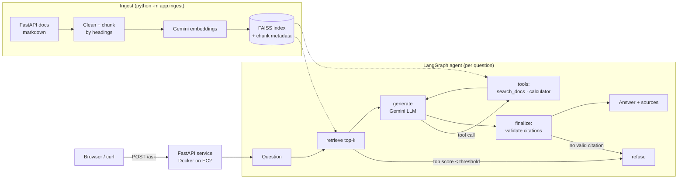

# Docs RAG Assistant

A question-answering assistant over the official [FastAPI documentation](https://fastapi.tiangolo.com)
(MIT licence, ~120 pages, ~1,100 chunks). Every answer cites the passages it used, and the assistant
says "I don't know" when the docs don't cover the question instead of guessing.

**Stack:** FastAPI · LangGraph · LangChain · Gemini API (LLM + embeddings) · FAISS · RAGAS ·
Docker · GitHub Actions · AWS EC2

## Architecture



### How refusal works (three layers)

1. **Retrieval gate:** if the best chunk's cosine similarity is below `MIN_SCORE`, the question is
   refused before the LLM is called (cheap, and stops off-topic prompts from using quota).
2. **Prompt rule:** the model must answer only from the numbered passages, or reply with a fixed
   refusal sentence.
3. **Citation check:** an answer with no valid `[n]` citation is turned into a refusal.

The agent can call `search_docs` to fetch more passages when the first ones are incomplete
(at most 2 hops), and `calculator` for arithmetic (safe AST evaluator, no `eval`).

## Evaluation

Golden set: [`eval/golden.jsonl`](eval/golden.jsonl), 30 questions: 20 answerable (each with the
expected source page and a reference answer) and 10 out-of-scope, including near-misses such as
Django ORM and Apollo GraphQL.

| Metric | Offline baseline* | Gemini (3.5 Flash-Lite + embedding-2) |
|---|---|---|
| Retrieval hit@4 (expected page retrieved) | 85.0% | **100%** |
| In-scope questions answered | 95.0% | **90.0%** |
| Citation accuracy (cites an expected page) | 68.4% | **100%** |
| Correct refusals (out-of-scope) | 100% | **100%** |
| False refusals (in-scope) | 5.0% | **10.0%** |
| RAGAS faithfulness | n/a | _pending_ |
| RAGAS answer relevancy | n/a | _pending_ |
| RAGAS context recall | n/a | _pending_ |

Gemini run: 5 Nov 2026, `MIN_SCORE=0.70` (from the sweep: out-of-scope questions scored 0.56–0.65,
in-scope 0.77–0.86), `TOP_K=4`. Both false refusals had the right page retrieved; the model chose to
say "I don't know", which is the cost of a strict grounding prompt.

\*Offline = hashing-vector embeddings + an extractive answerer, no API. It is the CI baseline that the
hosted models should beat.

```bash
python -m eval.run_eval --sweep     # choose MIN_SCORE (refusal vs false-refusal trade-off)
python -m eval.run_eval             # core metrics -> eval/results/<provider>.json
pip install -r requirements-eval.txt && python -m eval.run_eval --ragas   # + RAGAS
```

## Run it locally

```bash
pip install -r requirements-dev.txt
bash scripts/fetch_corpus.sh                  # downloads the docs into data/corpus

# No key needed: offline mode
python -m app.ingest && uvicorn app.api:app --reload

# With Gemini (free key from https://aistudio.google.com)
cp .env.example .env                          # set GOOGLE_API_KEY, PROVIDER=gemini
python -m app.ingest && uvicorn app.api:app --reload
```

Open http://localhost:8000 or:

```bash
curl -X POST localhost:8000/ask -H 'content-type: application/json' \
  -d '{"question": "How do I add CORS middleware?"}'
```

Response shape:

```json
{
  "answer": "<answer text with citations like [1]>",
  "refused": false,
  "refusal_reason": null,
  "citations": [{"id": 1, "title": "...", "section": "...", "url": "https://fastapi.tiangolo.com/...", "source": "tutorial/cors.md", "score": 0.0}],
  "latency_ms": 0
}
```

## Docker

```bash
docker build -t docs-rag .
docker run -p 8000:8000 --env-file .env -v rag-data:/app/data docs-rag
```

The image includes the corpus. The index is built on first start and kept in the `rag-data` volume.

## Deploy to AWS

See [`deploy/aws.md`](deploy/aws.md): budget alarm first, then a `t3.micro` EC2 instance running the
container.

## CI

GitHub Actions runs `ruff`, the unit tests (offline provider, no secrets), an offline eval on the
real corpus, then builds the Docker image and smoke-tests the container.

## Security

- `/ask` is limited to 10 requests per minute per IP and 400 per day in total (`RATE_LIMIT_PER_MINUTE`,
  `DAILY_ASK_LIMIT`), so the free-tier LLM quota can't be drained by one client or many.
- The calculator tool parses arithmetic with `ast` (no `eval`) and size-checks every intermediate result,
  so expressions like `((9**100)**100)**100` are rejected instead of exhausting CPU or memory.
- The API key lives only in `.env`, which is excluded from git and the Docker image. The container runs
  as a non-root user, and CI's GitHub token is read-only.
- Known, accepted: `ragas` (PYSEC-2026-3046) and `diskcache` (PYSEC-2026-2447) have advisories with no fix
  yet. They are local-only evaluation dependencies, not in the Docker image, and the affected code paths
  (multimodal file loading, a writable shared cache directory) are not used.

## Project layout

```
app/
  config.py     settings from env / .env
  ingest.py     clean -> chunk -> embed -> FAISS
  store.py      FAISS wrapper (cosine similarity)
  providers.py  Gemini or offline embeddings/LLM
  graph.py      LangGraph agent: retrieve, gate, generate, tools, citation check
  tools.py      search_docs, calculator
  api.py        FastAPI app (/ask, /health, web page), per-IP rate limit
eval/           golden set + evaluation script
tests/          pytest (graph paths, API, ingest, tools)
deploy/aws.md   EC2 deployment guide
```
